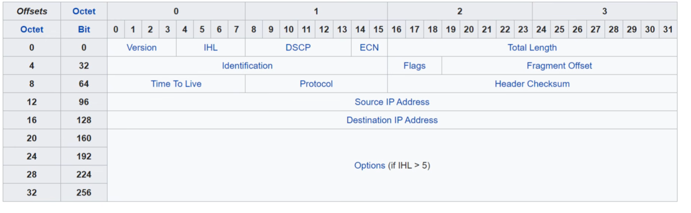

# BROADCAST ADDRESS ==>
      Is an Ip address used to send packets to every device on the same subnet at once.

# NETWORK ADDRESS ==> 
      Identifies the entire network/subnet, rather than one specific device.

# SUBNET MAS ==>
      A subnet mask is a 32-bit value used with an IPv4 address to identify which portion of the IP address represents the network and which portion represents the host.

# An IPv4 Address of : 15.255.255.254
would have:

# Subnet mast of: 255.0.0.0
# network Address of: 15.0.0.0
# Bradcast Address of: 15.255.255.255
# first usable IP ad: 15.0.0.1
# last usable IP ad: 15.255.255.254
.......................................

# 15.0.0.0 = network address becaus the last ZERO is reserved for the networ address.
# 15.255.255.255 = the last 255 is for the Bradcast Address.

So the only usable addresses are from:
# << 15.0.0.1 to 15.255.255.254 >>

# SENDER IP = 32 BITS
# DESTINATION IP =32 BITS

## IPv4 HEADER ##

An IPv4 header is the control information at the beginning of every IPv4 packet. Its minimum size is 20 bytes and maximum is 60 bytes.

 0                   1                   2                   3
 0 1 2 3 4 5 6 7 8 9 0 1 2 3 4 5 6 7 8 9 0 1 2 3 4 5 6 7 8 9 0 1
+-------+-------+---------------+-------------------------------+
|Version|  IHL  |   DSCP/ECN    |         Total Length          |
+-------------------------------+-------------------------------+
|         Identification        |Flags|     Fragment Offset     |
+-------------------------------+-----+-------------------------+
|      TTL      |   Protocol    |        Header Checksum        |
+---------------------------------------------------------------+
|                     Source IPv4 Address                       |
+---------------------------------------------------------------+
|                  Destination IPv4 Address                     |
+---------------------------------------------------------------+
|               Options (if any) + Padding                      |
+---------------------------------------------------------------+

The main fields are: Version (4 bits, value = 4), IHL (Internet header length), DSCP/ECN (traffic handling/congestion), Total Length (entire packet size), Identification + Flags + Fragment Offset (fragmentation), TTL (limits packet lifetime), Protocol (next-layer protocol, e.g. TCP=6, UDP=17, ICMP=1), Header Checksum (error checking of header), and Source/Destination Address (32 bits each).

A standard IPv4 header without options is 20 bytes = 160 bits.

# IHL
In IPv4, the IHL (Internet Header Length) field is measured in 32-bit words, and each word is 4 bytes.

Why does IHL increment by 4?

A 32-bit word = 4 bytes.

So:

IHL value	Header size
5 x 4 =	20 bytes
6 x 4 =	24 bytes
7 x 4 =	28 bytes
8 x 4 =	32 bytes
9 x 4 =	36 bytes
10 x 4 =	40 bytes
15 x 4 =	60 bytes

# Pv4 header  
#     Field	           What you should know

#     Version	       IPv4 = 4 X 8 = 32 Bits
#     IHL	             IPv4 header length; minimum 20 bytes
#     DSCP/ECN	       QoS/traffic handling and congestion notification
#     Total Length	 Size of the entire IPv4 packet
#     Identification	 Used with fragmentation
#     Flags	             Controls fragmentation, especially DF and MF
#     Fragment Offset	 Identifies where a fragment belongs
#     TTL ⭐	            Decreases   by 1 at every router hop; prevents packets looping forever
#     Protocol ⭐	      Identifies the upper-layer protocol
#     Header Checksum	 Detects errors in the IPv4 header
#     Source IP ⭐	      Sender's IPv4 address
#     Destination IP ⭐	Receiver's IPv4 address
#     Options	       Optional; makes the header larger than 20 bytes

# ⭐ Especially important for CCNA

You should be able to answer questions like:

# 1. What happens to TTL when a router forwards a packet? 
      PC → R1 → R2 → Server

      TTL 64
           ↓
      TTL 63
          ↓
      TTL 62
      Every router decreases TTL by 1.

# Note: TTL = mechanism that prevents the packet from looping forever.

# What does the Protocol field tell us?

It identifies the next-layer protocol carried inside the IPv4 packet.

Common values:

ICMP = 1
TCP  = 6
UDP  = 17
OSPF = 89

# OSI model → PDU names
OSI Layer	Layer	PDU
7	      Application	Data
6	      Presentation	Data
5	      Session	Data
# 4	      Transport	Segment (TCP) / Datagram (UDP)
# 3	      Network	Packet
# 2	      Data Link	Frame
1	      Physical	Bits

# ⭐ CCNA exam tip

# Know these three particularly well:

Layer 4 → Segment/Datagram (TCP/UDP)
Layer 3 → Packet (Network(IP))
Layer 2 → Frame (DataLink(MAC))

And remember:

IP = Packet
TCP = Segment
Ethernet = Frame

# DSCP = Differentiated Services Code Point

DSCP is used for QoS (Quality of Service). It tells network devices how a packet should be treated or prioritised.

Think of it like putting a priority label on a packet:

🚑 "This packet is important — handle it quickly."

┌───────────────┬───────────────┐
│     DSCP      │     ECN       │
│    6 bits     │    2 bits     │
└───────────────┴───────────────┘
       6 bits        2 bits

So:

DSCP = 6 bits
ECN = 2 bits

Together:

DS field = 8 bits

What does DSCP actually do?

Imagine a router receives:

Packet A → Voice call
Packet B → YouTube
Packet C → Email
Packet D → File download

The packets can have different DSCP values:

Voice       → High priority
Video       → Medium/high priority
Email       → Normal
File        → Lower priority

The router can then use those markings when deciding which packets should be forwarded first when there is congestion.

# ECN = Explicit Congestion Notification

ECN is the 2-bit part of the IPv4 DS field that helps networks deal with congestion without immediately dropping packets.

Think of it like a "traffic warning" 🚦.

# Without ECN

Imagine a router is becoming overloaded:

PC → → → → ROUTER → → → Server
             ⚠️
          Congested

Traditionally, the router may drop packets to signal congestion.

# With ECN

Instead of dropping the packet, the router can mark the packet to say:

"I'm getting congested — slow down."

The receiver can then notify the sender, and the sender can reduce its sending rate.

# Total Length IPv4 Header

Total Length is a 16-bit field in the IPv4 header.

It tells us the total size of the entire IPv4 packet.

That means:

# Total Length = IPv4 Header + Payload (Data)

Example

Suppose we have:

IPv4 Header = 20 bytes
Data        = 100 bytes

Then:

Total Length = 20 + 100
             = 120 bytes

So the Total Length field = 120 bytes.

What is the maximum?

Because the field is 16 bits:

2¹⁶ = 65,536

So the maximum IPv4 packet size is:

65,535 bytes

# IPv4 Identification Field

The Identification field is a 16-bit field in the IPv4 header.

Its main purpose is to help a device identify fragments that belong to the same original IP packet.

Why do we need it?

Imagine a large IP packet:

Original packet
┌──────────────────────────────┐
│       4,000 bytes            │
└──────────────────────────────┘

The network might have a link that can only carry smaller packets. The large packet may need to be fragmented:

Original packet
        ↓
 ┌──────────┐
 │ Fragment 1│
 ├──────────┤
 │ Fragment 2│
 ├──────────┤
 │ Fragment 3│
 └──────────┘

All three fragments need to be recognised as belonging to the same original packet.

That's where the Identification value helps.

For example:

Fragment 1 → Identification = 12345
Fragment 2 → Identification = 12345
Fragment 3 → Identification = 12345

The destination can see that these fragments have the same Identification value and know:

"These fragments came from the same original IPv4 packet."

# Important: Identification works with other fields

The Identification field doesn't work alone.

IPv4 also has:

# Identification 
       → identifies fragments from the same original packet
# Flags → 
      tells whether fragmentation is allowed / whether more fragments follow
# Fragment Offset → 
      tells where each fragment belongs

# Think of it like assembling a puzzle:

Identification → Which puzzle?
Fragment Offset → Where does this piece go?
Flags → Are there more pieces?

# CCNA exam point

Remember:

# Identification = 16 bits and is used for IPv4 fragmentation and reassembly.

# IPv4 Flags Field

The Flags field is a 3-bit field in the IPv4 header.

It is mainly related to fragmentation — breaking a large IP packet into smaller pieces.

The 3 bits are:

┌──────┬──────┬──────┐
│ Bit  │ Bit  │ Bit  │
│  0   │  1   │  2   │
└──────┴──────┴──────┘
   Reserved   DF    MF

# 1. Reserved bit

The first bit is reserved and must be 0.

You don't need to worry much about this for CCNA.

# 2. DF — Don't Fragment

DF = Don't Fragment

If DF = 1:

🚫 The router must not fragment the packet.

If the packet is too large for the next link's MTU(maximum transmition unit), the router will drop it and normally send an ICMP message back to the sender.

# If DF = 0:

Fragmentation is allowed.

# 3. MF — More Fragments

MF = More Fragments

This tells the destination whether more fragments are coming.

MF = 1

"There are more fragments after this one."

MF = 0

"This is the last fragment."

For example:

Original packet
      ↓
 Fragment 1 → MF = 1
 Fragment 2 → MF = 1
 Fragment 3 → MF = 0  ← last fragment
How it works with Identification

These three IPv4 fields work together:

Identification
      ↓
"Which original packet does this belong to?"

Fragment Offset
      ↓
"Where does this fragment go?"

Flags (MF)
      ↓
"Are there more fragments?"

 CCNA memory trick 🧠

DF = Don't Fragment

MF = More Fragments

And remember:

Flags = 3 bits
DF = 1 → Don't fragment
MF = 1 → More fragments are coming

# CMP

# ICMP = Internet Control Message Protocol

It is a network-layer protocol used by devices such as routers and hosts to send control, error, and diagnostic messages.

Think of ICMP as the network saying:

"Something happened to your IP packet, and I need to tell you about it."

Simple example: ping

When you run:

ping 192.168.1.10

your computer sends an ICMP Echo Request:

PC ───── ICMP Echo Request ─────> Server
PC <──── ICMP Echo Reply ─────── Server

If you receive the Echo Reply, you know the destination is reachable.

# IPv4 Header Checksum

The Header Checksum is a 16-bit field in the IPv4 header.

Its job is to check whether the IPv4 header has been corrupted or changed while travelling through the network.

Think of it like a quick error check for the header.

# Simple example

Imagine a packet leaves your PC:

# PC → Router → Router → Server

The sender calculates a checksum based on the IPv4 header and puts the result into:

      Header Checksum

When a router receives the packet, it checks the header checksum.

If the calculation doesn't match:

❌ Header may be corrupted

The packet can be discarded.

# Very important: it only checks the HEADER

It does not check the actual data/payload.

# NOTE
Layer 4 protocols like TCP or UDP can use their checksum to check for errors in the encapsulated data.

# OPTIONS
Option field can very in lenght from 0 to 320 bits. The other fields are fixed in length.