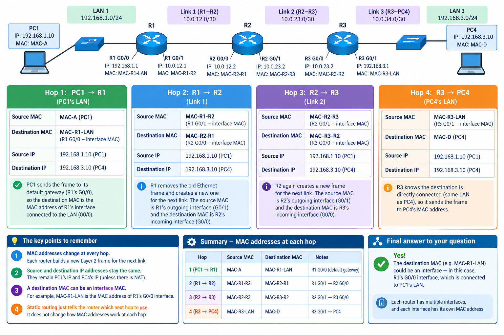
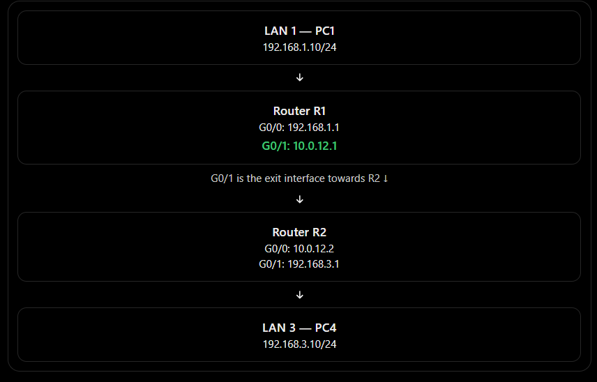
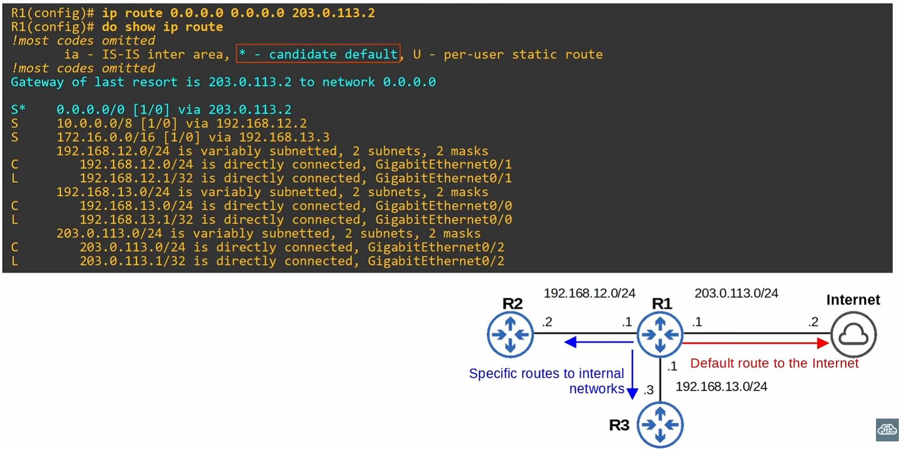
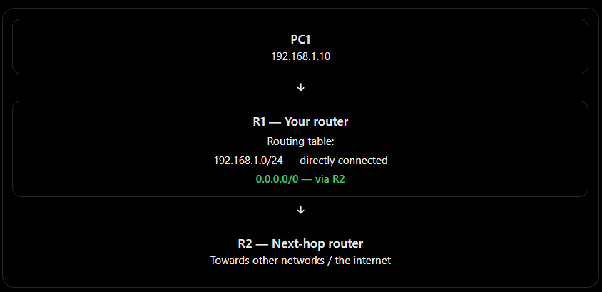
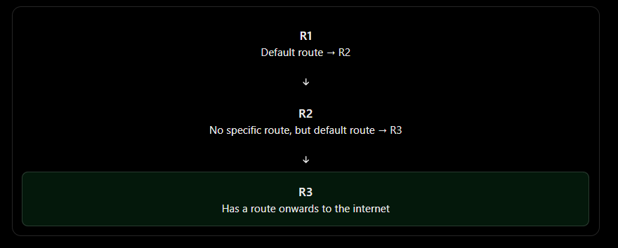

# multiple hops #

The method is the same however many hops there are: every router on the path needs its own route to each destination network it isn’t directly connected to. A longer path just means more routers, and so more routes.

# Example: five routers in a row

PC-A ---------── R1 ── R2 ── R3 ── R4 ── R5 ── PC-B
192.168.1.0  10.0.12.0  10.0.23.0  10.0.34.0  10.0.45.0  192.168.5.0

# Addressing rule: 
On link 10.0.XY.0/24, router X gets .X and router Y gets .Y. For example, on 10.0.23.0/24, R2 is 10.0.23.2 and R3 is 10.0.23.3.

PC-A: 192.168.1.10, gateway 192.168.1.1 (R1)
PC-B: 192.168.5.10, gateway 192.168.5.5 (R5)

# Going there to R5 (destination 192.168.5.0/24): each router points right
R1(config)# ip route 192.168.5.0 255.255.255.0 10.0.12.2
R2(config)# ip route 192.168.5.0 255.255.255.0 10.0.23.3
R3(config)# ip route 192.168.5.0 255.255.255.0 10.0.34.4
R4(config)# ip route 192.168.5.0 255.255.255.0 10.0.45.5
R5         → none needed, 192.168.5.0/24 is directly connected

# Coming back (destination 192.168.1.0/24): each router points left
R5(config)# ip route 192.168.1.0 255.255.255.0 10.0.45.4
R4(config)# ip route 192.168.1.0 255.255.255.0 10.0.34.3
R3(config)# ip route 192.168.1.0 255.255.255.0 10.0.23.2
R2(config)# ip route 192.168.1.0 255.255.255.0 10.0.12.1
R1         → none needed, 192.168.1.0/24 is directly connected

# Per router
# Router	     Route to 192.168.5.0 (right)	  Route to 192.168.1.0 (left)	   Total
R1 (edge)	     via 10.0.12.2	                  connected	                         1
R2 (middle)	     via 10.0.23.3	                  via 10.0.12.1	                     2
R3 (middle)	     via 10.0.34.4	                  via 10.0.23.2	                     2
R4 (middle)	     via 10.0.45.5	                  via 10.0.34.3	                     2
R5 (edge)	     connected	                      via 10.0.45.4	                     1

# The patterns
Edge routers need 1 route; middle routers need 2. Each edge router is already connected to one of the PC networks. A middle router is connected to neither, so it needs a route in each direction.
Number of routes for one PC-to-PC pair = 2 × (routers − 1).
3 routers (your R1-R3-R4 lab): 2 × 2 = 4 routes
4 routers: 2 × 3 = 6 routes
5 routers: 2 × 4 = 8 routes
The next hop is always the neighbour’s address on the shared link. It’s never the destination PC, and never a router two hops away. R1 can’t use R3’s address directly, because R1 has no connected network that R3 is on.
The IP addresses stay the same for the whole trip. At each hop, the MAC addresses are replaced and the TTL goes down by 1. With 4 routers, a Windows PC sees TTL=124 (128 − 4).

# What can go wrong on longer paths ?
One missing route breaks the whole path. If R3 is missing its route to 192.168.5.0/24, R1 and R2 forward the packet correctly and R3 drops it. Run traceroute from the PC. The last address that answers is the router before the problem.
A next hop pointing the wrong way causes a routing loop. If R3’s route to 192.168.5.0 pointed back to R2 (10.0.23.2), R2 would send the packet to R3 and R3 would send it back. The packet bounces until its TTL reaches 0. Traceroute then shows the same two addresses repeating.
Routers can’t ping link addresses that aren’t connected to them. For example, R1 can’t ping 10.0.34.4, because the routes above only cover the two PC networks. To make every address reachable, each router needs a route for every network it isn’t connected to. Five routers have 6 networks, which adds up to 20 static routes in total.

# Shortcut: default routes on the edge routers
An edge router has only one way out, so you can give it a default route instead of listing every network:

R1(config)# ip route 0.0.0.0 0.0.0.0 10.0.12.2
R5(config)# ip route 0.0.0.0 0.0.0.0 10.0.45.4

0.0.0.0 0.0.0.0 means “any destination I don’t have a more specific route for.” Middle routers still need specific routes, because traffic can leave them in two directions and a single default route can only point one way.

# When to stop using static routes
Static routes work well for small labs and simple chains of 3 or 4 routers. They don’t scale well:

Every new network means editing several routers.
If a link fails, static routes don’t switch to the backup path. In your topology, R1 → R2 → R4 is the backup.
That’s why larger networks use a dynamic routing protocol such as OSPF. The routers learn all these routes on their own and recalculate when a link fails.

# DATA TRAVELING VIA DIFFERENT HOPS(ROUTERS)

Here’s a clearer diagram showing the full journey from PC1 to PC4, with the MAC addresses at every hop.

# The most important part to remember:
- PC1 → R1: Destination MAC = R1’s G0/0 interface MAC.
- R1 → R2: Destination MAC = R2’s receiving interface MAC.
- R2 → R3: Destination MAC = R3’s receiving interface MAC.
- R3 → PC4: Destination MAC = PC4’s MAC address.

# Remember: 
Every router-to-router link uses the MAC addresses of the two interfaces connected to that link. The IP addresses stay the same throughout normal routing, but the MAC addresses change at each hop.
 

# 1. What is an exit interface?
An exit interface is the router interface through which a packet leaves the router to travel towards its destination.

For example, imagine this network:

LAN 1 — PC1
192.168.1.10/24
---------------
    |
Router R1
G0/0: 192.168.1.1
G0/1: 10.0.12.1
---------------
    |
G0/1 is the exit interface towards R2 ↓
---------------
    |
Router R2
G0/0: 10.0.12.2
G0/1: 192.168.3.1
    |
---------------
LAN 3 — PC4
192.168.3.10/24

Suppose R1 wants to reach the remote network 192.168.3.0/24.

R1 must send packets out of its G0/1 interface towards R2.
2. Configure the static route using the exit interface
On R1, enter:
# R1(config)# ip route 192.168.3.0 255.255.255.0 GigabitEthernet0/1

# 3. How is this different from using a next-hop IP?
You can configure a static route in three common ways.

# Method 1: Exit interface
ip route 192.168.3.0 255.255.255.0 g0/1
Specifies the interface the packet leaves through.

# Method 2: Next-hop IP address
ip route 192.168.3.0 255.255.255.0 10.0.12.2
Specifies the next router's IP address.

# Method 3: Both
ip route 192.168.3.0 255.255.255.0 g0/1 10.0.12.2
Specifies both the exit interface and next-hop IP address.

# DEFAULT ROUTE
A default route is a route a router uses when it does not have a more specific matching route in its routing table for the destination IP address.

Think of it as the router's “if I don't know where to send it, send it this way” rule.
# 1. Understand it with a diagram

Suppose PC1 sends a packet to 8.8.8.8.
1. R1 checks its routing table.
2. R1 cannot find a more specific route for 8.8.8.8.
3. R1 uses its default route and forwards the packet towards R2.
2. What does 0.0.0.0/0 mean?
A default route is commonly written as:

0.0.0.0/0
- 0.0.0.0 is the destination network address used in the route.
- /0 means zero network bits are fixed.
- Therefore, it can match any IPv4 destination address, provided no more specific usable route takes precedence.

# Let's break it down.
- 0.0.0.0 — the destination network address specified in the route.
- /0 — zero network bits are fixed, so the route can match any IPv4 destination.
An IPv4 address contains 32 bits.

For example:
8.8.8.8
00001000.00001000.00001000.00001000

With a /0 prefix, the router doesn't need any of those 32 bits to match a particular network prefix. That is why a default route can match any IPv4 destination.
Compare these routes

# /24 Specific route
Matches addresses within one particular /24 network.

# /16 Broader route
Matches a larger network than a /24.

# /0 Default route
Matches any IPv4 destination as a fallback.

# YES! Exactly! ✅ If R1 needs to send traffic to networks it doesn't have a specific route for, you can configure a default route pointing to R2.

Imagine this topology:

PC1 → R1 → R2 → R3 → Internet
Step 1: Configure the default route on R1
Suppose R1 connects to R2 using the IP address 10.0.12.2 on R2.

On R1, you would enter:
R1(config)# ip route 0.0.0.0 0.0.0.0 10.0.12.2

# Good question! 🔥 This is where you need to understand that every router makes its own routing decision.

Imagine this topology:

PC1 → R1 → R2 → R3 → Internet
What if R2 doesn't have a route either?
Suppose PC1 wants to reach Google's DNS server, 8.8.8.8.
1. R1: Doesn't have a specific route to 8.8.8.8, so it uses its default route and forwards the packet to R2.
2. R2: Checks its routing table. If it has a default route to R3, it forwards the packet to R3.
3. R3: Checks its routing table. If it has a route onwards to the internet, it forwards the packet.

R1
Default route → R2

R2
No specific route, but default route → R3

R3
Has a route onwards to the internet

# But what if R2 has NO default route either?
If R2 has no matching specific route and no default route, it cannot forward the packet towards its destination.
- R2 drops the packet.
- R2 may send an ICMP Destination Unreachable message back to the source.
- The communication fails.

# How do network engineers solve this?
They configure routes so that traffic has a path towards its destination. For example:

On R1:
ip route 0.0.0.0 0.0.0.0 10.0.12.2

On R2:
ip route 0.0.0.0 0.0.0.0 10.0.23.3

Here, R1 forwards unknown destinations to R2, and R2 forwards its unknown destinations to R3. The example assumes those next-hop IP addresses are reachable through the respective router links.

Remember for your CCNA: A default route doesn't magically find the destination. It tells a router where to send traffic when no more-specific matching route exists.

# No! You do NOT have to configure a default route on every router. ✅ It depends on the role of each router and how the network is designed.

Let's use your example with 6 routers.
Example: A network with 6 routers

R1
Default route → R2

R2
Default route → R3

R3
Specific routes or default route → R4

R4

R5

R6 — Internet connection

In this example, R1 and R2 have default routes. R3 might use specific routes, and R4 and R5 might use routes learned through a routing protocol such as OSPF. They don't necessarily need default routes.
When would each router need a default route? 

# Router	                Default route needed?
R1 — branch router	        Often, yes
R2 — intermediate router	Depends on its routing table
R3 — core router	        Not necessarily
R4 — intermediate router	Not necessarily
R5 — intermediate router	Not necessarily
R6 — internet-edge router	Often has a default route to its ISP

The key is that each router needs a valid route for the destinations it must reach, but that route doesn't always have to be a default route.

For example, R3 could have specific routes to all the networks it needs to reach, or learn those routes using OSPF.

# One more important point:
 if R1 sends traffic through R2 and R3 to reach a destination, the network also needs a valid path for the return traffic.

# Quick CCNA question
You have six routers. R1 has a default route to R2. R2 has a specific route to the destination network. Does R2 also need a default route to forward that packet?
- A. Yes, every router must have a default route.
- B. No, R2 can use its specific matching route. Correct
- C. Yes, because R1 used a default route.