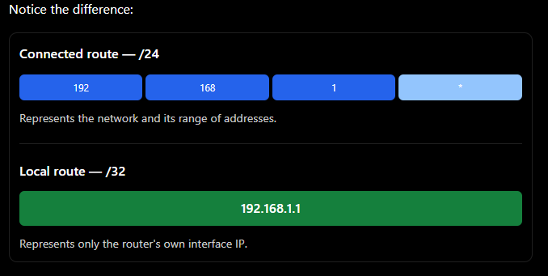
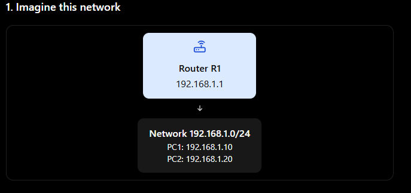

# ROUNTING #

# ROUTING
    Routing is the process of choosing the best path for data to travel from one network to another.

Imagine you want to send a parcel from your house in London to a friend in Manchester. The parcel needs to travel through the correct roads to reach its destination.

In networking, routers work like traffic directors. They decide where network packets should go so they can reach their destination.

If the destination is directly connected to the ROUTER, send the packet directly to the destination.

If the destination is directly connected to the router, send the packet directly to the destination(to itself, dont forward it).

# 1. Let's visualise routing

      
PC1 — Network A

IP: 192.168.1.10
        
Packet leaves PC1

Router R1

Examines the destination IP address

Chooses the next hop

Packet is forwarded

PC2 — Network B

IP: 192.168.2.10

Simplified example: the router connects the two different networks.

# Here is what happens:

PC1 wants to send data to 192.168.2.10.

PC1 recognises that the destination is on a different network.

PC1 sends the packet to its default gateway, which is the router.

The router checks the destination IP address.

The router looks at its routing table to decide where to forward the packet.

The packet travels to Network B and eventually reaches PC2.

# That decision-making process is called routing.

# 2. Why do we need routing?

Imagine a company has four departments.

Suppose a Sales PC needs to access a server in the Servers network.

The Sales PC belongs to 192.168.10.0/24.

The server belongs to 192.168.40.0/24.

These are different networks.

A router or a Layer 3 switch routes traffic between them.

Without a route to the destination network, the router cannot forward the packet towards that network.

# Important: 
    Routing does not automatically mean traffic is permitted. Firewalls and access control lists (ACLs) can still block it.

# 3. What is a routing table?

A routing table is a list of routes that tells a router where to send packets.

Think of it like a sat-nav. The sat-nav knows different destinations and which roads to take. A router's routing table contains destination networks and instructions for reaching them.

# 4. How does a router learn routes?

There are three important ways to learn routes, especially for your CCNA studies.

# 1. Connected routes

A router learns these automatically when an interface has an IP address configured and is operational.

Example: 
R1 has 192.168.1.1/24 on an interface, so it learns the directly connected network 192.168.1.0/24.

# Local Route (L)

Definition: A local route is a route automatically added to a router's routing table to identify the specific IP address assigned to its own interface.

Example:

Router interface: 192.168.1.1/24
Local route:      192.168.1.1/32

# Imagine your router is connected to a network

Router R1
IP: 192.168.1.1
        ↓
Network: 192.168.1.0/24
PC1 · PC2 · PC3

Your router has the IP address 192.168.1.1, and it is connected to the network 192.168.1.0/24.

# Now, the router automatically adds two routes to its routing table.

# 1. Connected route (C) — the whole network

# Imagine the router saying:

"I am directly connected to the network 192.168.1.0/24. I can reach devices on this network through my interface."

That is the connected route.

C 192.168.1.0/24

Think of C as the router knowing which network is connected to it.

# 2. Local route (L) — the router's own IP

Now imagine the router saying:

"My own IP address on this interface is 192.168.1.1."

That is the local route.

L 192.168.1.1/32

Think of L as the router identifying its own IP address, not the whole network.

# NOTE (REALLY IMPORTANT):
The router adds its own IP address to the routing table so it knows that traffic destined for that IP address is meant for the router itself, not another device.

2. What happens when traffic arrives?

Imagine PC1 sends a ping to 192.168.1.1.

That destination IP address belongs to Router R1.

The router can recognise this because it has a local route:

L 192.168.1.1/32

The router knows the destination is one of its own IP addresses, so it processes the packet itself. For example, it can reply to the ping.
Now imagine PC1 sends a packet to 192.168.1.20, which belongs to PC2.

# 2. Static routes

A network administrator manually configures the path.

Example: You tell R1 to reach 192.168.3.0/24 through 10.0.0.2.

Cisco command:

ip route 192.168.3.0 255.255.255.0 10.0.0.2

# 3. Dynamic routing

Routers use routing protocols to exchange information about networks and learn routes automatically.

Examples:

# OSPF — Open Shortest Path First

# EIGRP — Enhanced Interior Gateway Routing Protocol

# BGP — Border Gateway Protocol

If the network changes, dynamic routing protocols can recalculate routes and adapt.

# 6. What happens to a packet when it is routed?

Imagine PC1 sends a packet through R1 to PC2 on another network.

PC1 creates an IP packet with the destination IP address of PC2.

PC1 puts the packet inside an Ethernet frame addressed to its default gateway's MAC address.
R1 receives the frame, removes the Ethernet header and examines the destination IP address in the packet.

R1 consults its routing table and selects the best matching route.

R1 forwards the packet in a new frame on the outgoing interface. The Layer 2 addresses are appropriate for the next link, while the destination IP normally remains PC2's IP address.

# One more CCNA detail: 
when a router forwards an IPv4 packet, it decreases the TTL (Time to Live) by one and updates the IPv4 header checksum. This helps prevent packets from looping forever.

