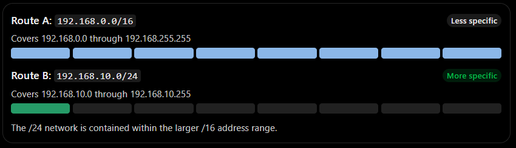
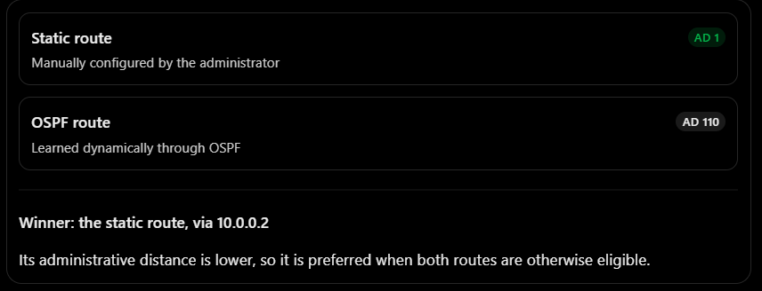
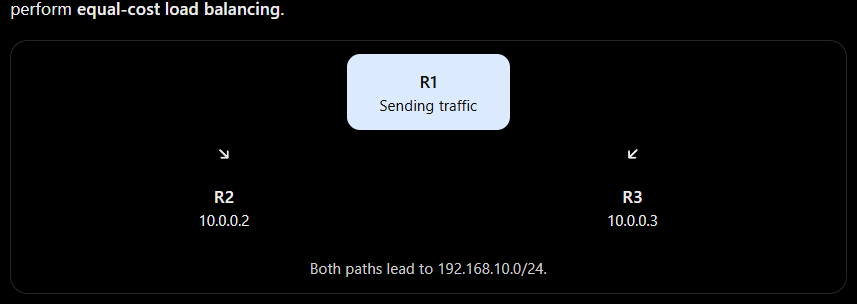
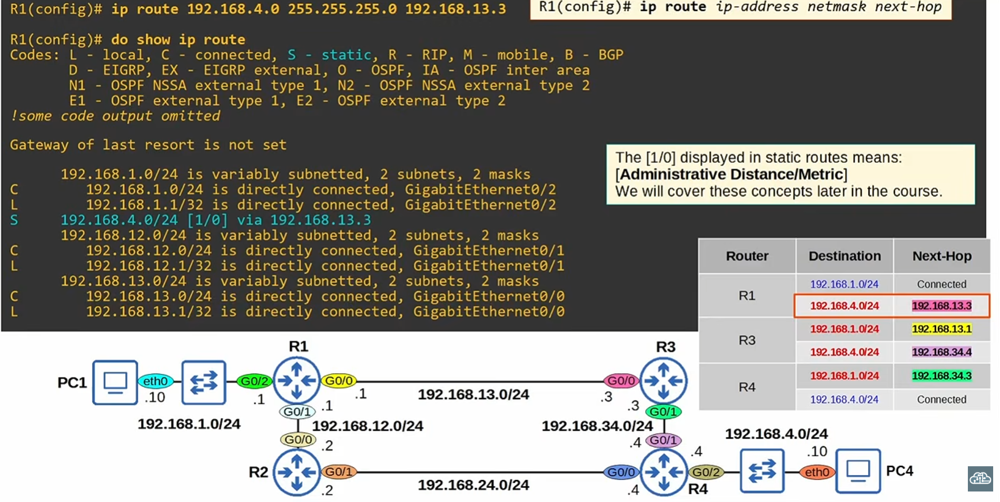

# CCNA: Understanding Similar Routes Properly
Let's slow down and build this from the beginning. This is one of the most important concepts in routing because a router can have several possible routes for the same destination, and it must decide which one to use.

# There are three different questions you must learn to answer:
    1. If two routes match the destination, which route is more specific?

    2. If two routes lead to the same network but come from different sources, which route does the router prefer?

    3. If two routes are equally good, can the router use both?

These questions sound similar, but the answers are different.
# 1. First, understand what a route tells a router
Imagine your router has this routing table:

#   Destination network	     Next hop
    192.168.1.0/24	         10.0.0.2
    192.168.2.0/24	         10.0.0.3
    192.168.3.0/24	         10.0.0.4

Each route tells the router where to forward packets destined for a particular network.

For example, a packet destined for 192.168.2.50 matches the second route. The router sends it towards 10.0.0.3.

# But what happens when the routing table contains two routes that both match the same destination IP address?

That's where things get interesting.
# 2. Situation one: Two routes with different prefix lengths
Suppose R1 has these two routes:

S 192.168.0.0/16    via 10.0.0.2
S 192.168.10.0/24   via 10.0.0.3

# Think of these as two roads:
- Route A is a major road that can take you to a large area.
- Route B is a smaller road that takes you to a specific neighbourhood inside that area.
Both roads can lead to your destination, but one is more specific.

# Route A: 192.168.0.0/16   Less specific
Covers 192.168.0.0 through 192.168.255.255
# ==== ==== ==== ==== ==== ==== ==== ==== ====

# Route B: 192.168.10.0/24      More specific
Covers 192.168.10.0 through 192.168.10.255
# ==== === === === === === === === ===

The /24 network is contained within the larger /16 address range.

# Now imagine a packet arrives for: 192.168.10.50

# Which route matches?
- Route A matches because 192.168.10.50 is inside 192.168.0.0/16.
- Route B also matches because 192.168.10.50 is inside 192.168.10.0/24.
The router uses Route B, via 10.0.0.3.

# Why? 
Because /24 is a longer prefix than /16. It identifies a smaller, more specific range of IP addresses.

# This decision is called longest-prefix match.

What does the slash number mean?
The number after the slash tells you how many bits of the IPv4 address identify the network prefix.
- /16 means 16 network-prefix bits.
- /24 means 24 network-prefix bits.
- /32 means all 32 bits must match, identifying one exact IPv4 address.
The higher the prefix length, the more specific the route generally is.

# CCNA rule: 
    If two routes match the same destination IP but have different prefix lengths, the router chooses the route with the longest matching prefix.

# FOR DIFFERENT PREFIX LENGTH IF Now imagine a packet arrives for: 192.168.11.50 IT WOULD match Route A because it will be out of range for route B ?

YES! Exactly right. ✅ You've understood the concept.

Let's use the same two routes:
# Route	  Destination          network	Range
Route A	  192.168.0.0/16	   192.168.0.0 – 192.168.255.255
Route B	  192.168.10.0/24	   192.168.10.0 – 192.168.10.255

# Example 1
Destination: 192.168.10.50
Matches Route A and Route B.
Winner: Route B (/24), because it is more specific.

# Example 2
Destination: 192.168.11.50
Matches Route A, but not Route B.
Winner: Route A (/16), because Route B does not cover this address.

# Example 3
Destination: 192.168.200.100
Matches Route A, but not Route B.
Winner: Route A (/16) for the same reason.

# 3. Situation two: Same destination network, but different routing sources

Now let's change the example.

R1 has learned the same destination network in two different ways:

S 192.168.10.0/24 [1/0] via 10.0.0.2
O 192.168.10.0/24 [110/20] via 10.0.0.3

Let's decode this carefully.
- S means static route.
- O means OSPF route.
- [1/0] means administrative distance 1, metric 0.
- [110/20] means administrative distance 110, metric 20.

Both routes lead to exactly the same network: 192.168.10.0/24.

# So, which one does R1 prefer?

# Static route                                AD 1
Manually configured by the administrator

# OSPF route                                    AD 110
Learned dynamically through OSPF

# Winner: the static route, via 10.0.0.2

Its administrative distance is lower, so it is preferred when both routes are otherwise eligible.

Why does administrative distance matter?
Administrative distance (AD) is Cisco's measure of how trustworthy a route's source is.

# The default values you should know for CCNA are:

# Route source	      AD
Directly connected	  0
Static	              1
EIGRP internal	      90
OSPF	              110
RIP	                  120

# NOTE:
A lower AD is preferred when the router compares competing routes to the same destination prefix.

For example, if a static route and an OSPF route both advertise 192.168.10.0/24, the static route normally wins because 1 is lower than 110.

If the static route becomes unavailable and OSPF still has a valid path, OSPF can take over.

# Important distinction
Administrative distance does not mean that a /16 route automatically loses to a /24 route just because the /16 has a higher AD.

Prefix length and administrative distance answer different questions:
- Prefix length: Which installed route most specifically matches this destination?
- Administrative distance: Which route source should be preferred for the same prefix?
Keep these two concepts separate in your mind.

# 4. Situation three: Two static routes with the same prefix
Now imagine R1 has these two commands configured:

R1(config)# ip route 192.168.10.0 255.255.255.0 10.0.0.2
R1(config)# ip route 192.168.10.0 255.255.255.0 10.0.0.3

Both routes have:
- The same destination network.
- The same subnet mask.
- The same default administrative distance of 1.
- The same default static-route metric.
Assuming both next hops are reachable and both routes are eligible, Cisco IOS can install both routes and perform equal-cost load balancing.

Instead of keeping only one route, R1 can use both next hops.

# Note:
However, do not assume that every individual packet alternates between R2 and R3. Traffic distribution depends on the platform and forwarding method; it may use flow-based hashing.

# CCNA takeaway:
     Equal-cost paths can be used for load balancing. Different-cost paths do not automatically qualify for equal-cost load balancing.

# 5. Situation four: A floating static route
What if you want one route to be the main path and another to be a backup?

You can configure a floating static route by giving it a higher administrative distance.

For example:

R1(config)# ip route 192.168.10.0 255.255.255.0 10.0.0.2
R1(config)# ip route 192.168.10.0 255.255.255.0 10.0.0.3 10

The first route has the default AD of 1. The second route has AD 10.

# Route	            Next hop	AD	Role
Primary   static	10.0.0.2	1	Main path
Floating  static	10.0.0.3	10	Backup path

# Normally, R1 uses 10.0.0.2.

If that route is withdrawn from the routing table, and the alternative remains valid, R1 can install and use the floating static route through 10.0.0.3.

# Be aware that a floating static route is not a guarantee of end-to-end failover: 
The router must detect that the primary route is unavailable. A route whose next-hop interface remains up despite a failure farther along the path may need additional tracking or detection.

