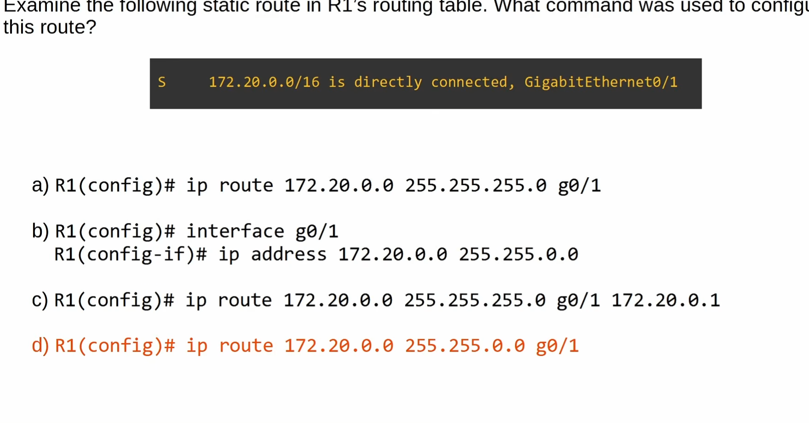
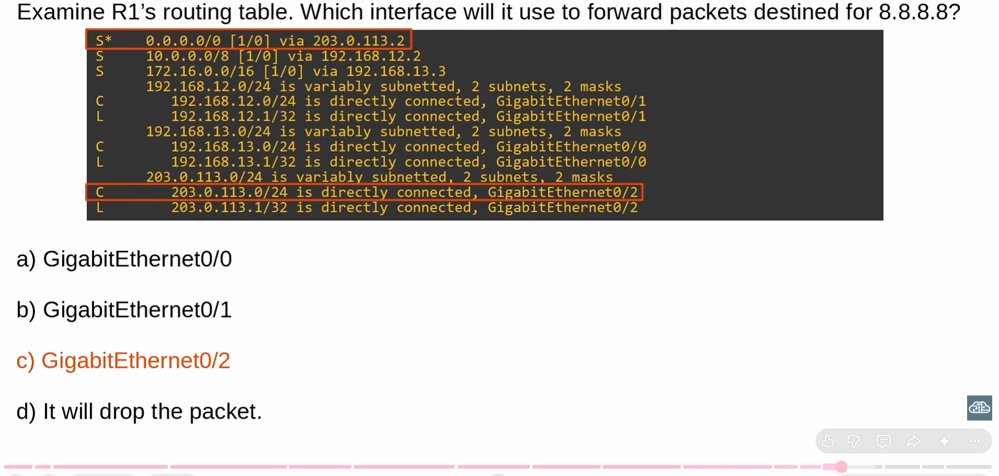
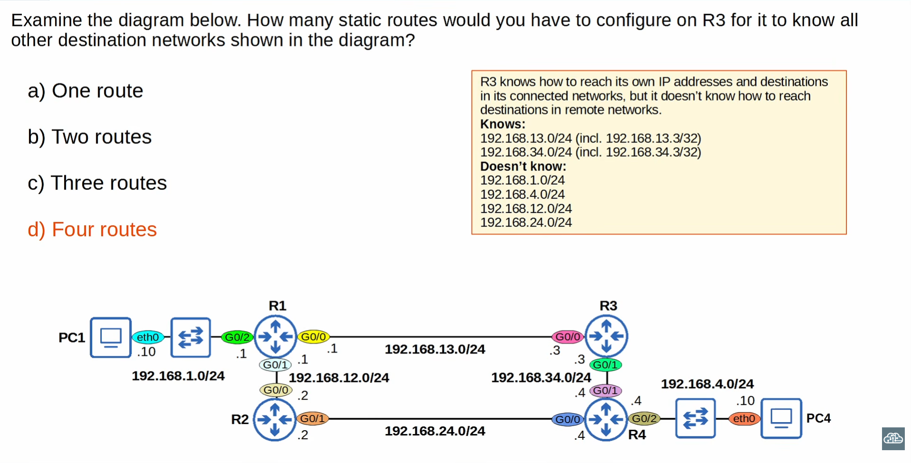

The correct answer is D:
R1(config)# ip route 172.20.0.0 255.255.0.0 g0/1

Let's understand why, step by step.
1. Read R1's routing table
The question shows:
# S 172.20.0.0/16 is directly connected, GigabitEthernet0/1

Break it down:
- S —> the route was manually configured as a static route.
- 172.20.0.0/16 —> the destination network.
- directly connected, GigabitEthernet0/1 — the route specifies the outgoing interface, G0/1, rather than displaying a next-hop IP address.
Important: A static route can specify an outgoing interface without specifying a next-hop IP address. This is called an exit-interface static route.
2. Why is the subnet mask 255.255.0.0?
The routing table shows /16.

A /16 prefix means the first 16 bits are network bits, giving this subnet mask:

255.255.0.0

So the command must use:
ip route 172.20.0.0 255.255.0.0 g0/1

3. Why are the other options wrong?
Option	Why it's wrong
# A	Uses 255.255.255.0, which is /24, not /16.
# B	Configures an interface IP address, not a static route.
# C	Uses /24 and also specifies a next-hop IP address. It doesn't match the displayed /16 route.
# D	Correct: uses the /16 mask and specifies G0/1 as the exit interface.
4. Remember the static route command format
The general format is:
# ip route <destination-network> <subnet-mask> <next-hop-IP OR exit-interface>

You can configure a route using either:

# Option 1 — Next-hop IP address
# ip route 172.20.0.0 255.255.0.0 192.168.1.2

# Option 2 — Exit interface
# ip route 172.20.0.0 255.255.0.0 g0/1

Both specify a static route, but they identify how to reach the destination differently.

# Question 2

The correct answer is:
# C) GigabitEthernet0/2.

Let's break it down step by step, because this question tests your understanding of default routes and routing tables for the CCNA.
Step 1: Find the destination IP address
The question asks where R1 will forward a packet destined for:

8.8.8.8

Look at R1's routing table. Is there a specific route for 8.8.8.8?

No. There is no route for the 8.8.8.0 network shown.
Step 2: Find the default route
Look at this entry:
S*  0.0.0.0/0 [1/0] via 203.0.113.2

Here's what each part means:
# Entry	     Meaning
S	              Static route
*	              Candidate default route
0.0.0.0/0	      Matches any IPv4 destination
[1/0]	          Administrative distance 1, metric 0
via 203.0.113.2	  Send the packet to this next-hop IP

Because R1 has no more specific route matching 8.8.8.8, it uses the default route and forwards the packet to 203.0.113.2.
Step 3: Find the outgoing interface
Now look for the connected route containing 203.0.113.2.

The routing table shows:
C 203.0.113.0/24 is directly connected, GigabitEthernet0/2

R1's own IP on that interface is:
L 203.0.113.1/32 is directly connected, GigabitEthernet0/2

Therefore, the next-hop IP 203.0.113.2 is reachable through GigabitEthernet0/2.

# Question 3
