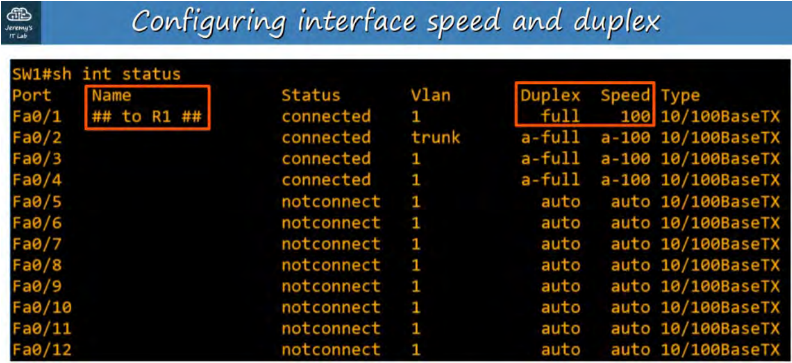

# 🔵 Layer 2 Switch

A Layer 2 switch is a network device that forwards Ethernet frames within a LAN based on MAC addresses.

# It:

Uses a MAC address table to decide where to forward frames.
Connects devices such as PCs, printers, and servers.
Can create and manage VLANs.
Does not normally route traffic between different IP networks/VLANs.
Does not need an IP address to perform its basic switching function. An IP can be configured for management.

Think:
Layer 2 = MAC addresses → switching frames

# 🟢 Layer 3 Switch

A Layer 3 switch is a switch that can perform both Layer 2 switching and Layer 3 routing between different IP networks or VLANs.

It:

Does everything a Layer 2 switch does.
Uses MAC addresses for normal Layer 2 switching.
Uses IP addresses and routing tables to route between different networks/VLANs.
Can act as the default gateway for VLANs.
Can perform routing much faster than traditional router-on-a-stick designs in many LAN environments.

Think:
Layer 3 = MAC addresses + IP addresses → switching + routing.

# OSPF:
     is a dynamic routing protocol that allows routers and Layer 3 switches to automatically learn about networks and determine the best path to reach them.

# 🔵 Static Routing

Static routing is a method where a network administrator manually configures a specific route to tell a router or Layer 3 switch how to reach a particular network.

Simple: You manually tell the device where to send the traffic.

# 🟢 Dynamic Routing

Dynamic routing is a method where routers or Layer 3 switches use a routing protocol to automatically exchange routing information and learn the best available paths to different networks.

Simple: The devices learn routes automatically and can adjust when the network changes.

🧠 Remember

Static = manually configured routes

Dynamic = automatically learned routes.

# DUPLEX

# 1. Half-Duplex

Half-duplex is a communication mode where a device can send and receive data, but not at the same time.

# Example: A walkie-talkie. If Person A is speaking, Person B must wait. When A stops, B can speak.

A ───────→ B
   SEND

B ───────→ A
   SEND

Key point: One direction at a time.

# 2. Full-Duplex

Full-duplex is a communication mode where a device can send and receive data simultaneously.

Example: A telephone call. You can speak while the other person is speaking, and both directions can carry data at the same time.

A ─────────→ B
A ←───────── B

Key point: Both directions at the same time.

# 3. Auto-Duplex / Auto Negotiation

Auto-negotiation is a feature that allows two connected network devices to automatically negotiate and select a compatible speed and duplex mode.

Example: A PC connects to a switch. Both devices support full-duplex, so they automatically agree to use full-duplex.

PC  ←── Auto-negotiation ──→  Switch

        ↓

   Full-duplex

Key point: The devices automatically decide the appropriate duplex mode.

🧠 Remember

Half-duplex → send OR receive

Full-duplex → send AND receive

Auto-negotiation → devices automatically agree on the mode (and commonly speed).

# CSMA/CD

# CSMA/CD stands for:

Carrier Sense Multiple Access with Collision Detection

It is a method used by Ethernet devices to manage communication when multiple devices share the same network medium.

# Proper definition

CSMA/CD is a network access method where devices listen to the network before transmitting, detect collisions if two devices transmit at the same time, and retransmit after waiting for a random period.

How it works

Imagine two computers sharing the same Ethernet connection:

PC1 ───────────────┐
                   ├── Shared network
PC2 ───────────────┘

1. Carrier Sense
PC1 listens to see if the network is being used.

2. Multiple Access
Multiple devices are allowed to use the same network.

3. Transmit
If the network is free, PC1 sends its data.

4. Collision Detection
If PC1 and PC2 transmit at the same time:

PC1 ───────→
             💥 COLLISION
PC2 ───────→

Both devices detect the collision.

5. Backoff
They stop transmitting, wait for a randomly selected amount of time, and then try again.

# 🧠 Important CCNA point

CSMA/CD is associated with half-duplex Ethernet, where collisions can occur.

# NOTE:
    Modern switched Ethernet normally uses full-duplex, so collisions generally do not occur, meaning CSMA/CD is not needed.

# Common interface errors in a SWITCH (same as in a Router)
Error	        Meaning
CRC errors	    Frame was received with corrupted data
Input errors	General errors while receiving frames
Output errors	Problems while transmitting frames
Collisions	    Two devices transmitted at the same time
Late collisions	  Collision detected after the expected time
Runts	   Ethernet frames smaller than the minimum allowed size
Giants	   Ethernet frames larger than the maximum allowed size

# INTERFACE RANGE
Unused Interfaces can pose a security risk so it's a good idea to deactivate them.
# However, if you have 28+ interfaces not in use, do you have to do them one at a time?
# Answer: No! 
    There is a command to apply configurations to a range of interfaces.
    Inside Global Config Mode (config t):

# SW1(config)#interface range f0/5 - 12 // Choose all interfaces from 0/5 to 0/12
# SW1(config-if-range)#description ## not in use ##
# SW1(config-if-range)#shutdown
<< this will list all the interfaces being set to administratively down >>
Confirm with 'show interface status' in Privileged EXEC mode or if in CONFIG mode, use 'do show
interface status'.

# SWITCHES are more sophisticated than HUBS.
HUBS are Layer 1 Devices - Collisions are common and use CSMA/CD. SWITCHES are Layer 2 Devices
- Collisions RARELY occur.

# SPEED / DUPLEX AUTONEGOTIATION
• Interfaces that can run at different speeds (10/100 or 10/100/1000) have a default setting of
SPEED AUTO and DUPLEX AUTO.
• Interfaces 'advertise' their capabilities to the neighbouring device, and they negotiate the best
SPEED and DUPLEX settings they are both capable of.

# WHAT if AUTONEGOTIATION is DISABLED on the device connected to the SWITCH ?
SPEED: The SWITCH will try to send at the speed that the other device is operating at. If it fails
to send the speed, it will use the slowest supported speed (ie: 10 Mbps on a 10/100/1000
interface).
• DUPLEX: If the speed is 10 or 100 Mbps the SWITCH will use HALF DUPLEX. If the speed is
1000 Mbps or great, it will use FULL DUPLEX.

### Interface configuration, (do show int status) command only works on Switches not Routers ###
SW1>en
SW1#conf t
Enter configuration commands, one per line.  End with CNTL/Z.
SW1(config)#
SW1(config)#
SW1(config)#
SW1(config)#do show int status
Port      Name               Status       Vlan       Duplex  Speed Type
Fa0/1                        connected    1          auto    auto  10/100BaseTX
Fa0/2                        connected    1          auto    auto  10/100BaseTX
Fa0/3                        notconnect   1          auto    auto  10/100BaseTX
Fa0/4                        notconnect   1          auto    auto  10/100BaseTX
Fa0/5                        notconnect   1          auto    auto  10/100BaseTX
Fa0/6                        notconnect   1          auto    auto  10/100BaseTX
Fa0/7                        notconnect   1          auto    auto  10/100BaseTX
Fa0/8                        notconnect   1          auto    auto  10/100BaseTX
Fa0/9                        notconnect   1          auto    auto  10/100BaseTX
Fa0/10                       notconnect   1          auto    auto  10/100BaseTX
Fa0/11                       notconnect   1          auto    auto  10/100BaseTX
Fa0/12                       notconnect   1          auto    auto  10/100BaseTX
Fa0/13                       notconnect   1          auto    auto  10/100BaseTX
Fa0/14                       notconnect   1          auto    auto  10/100BaseTX
Fa0/15                       notconnect   1          auto    auto  10/100BaseTX
Fa0/16                       notconnect   1          auto    auto  10/100BaseTX
Fa0/17                       notconnect   1          auto    auto  10/100BaseTX
Fa0/18                       notconnect   1          auto    auto  10/100BaseTX
Fa0/19                       notconnect   1          auto    auto  10/100BaseTX
Fa0/20                       notconnect   1          auto    auto  10/100BaseTX
Fa0/21                       notconnect   1          auto    auto  10/100BaseTX
Fa0/22                       notconnect   1          auto    auto  10/100BaseTX
Fa0/23                       notconnect   1          auto    auto  10/100BaseTX
Fa0/24                       notconnect   1          auto    auto  10/100BaseTX
Gig0/1                       notconnect   1          auto    auto  10/100BaseTX
Gig0/2                       connected    1          auto    auto  10/100BaseTX

SW1(config)#
SW1(config)#
SW1(config)#int g0/1
SW1(config-if)#speed 1000
SW1(config-if)#duplex full
SW1(config-if)#
%LINK-5-CHANGED: Interface GigabitEthernet0/1, changed state to up

%LINEPROTO-5-UPDOWN: Line protocol on Interface GigabitEthernet0/1, changed state to up
SW1(config-if)#desc ## to R1 ##

# Note
F0/1 vs G0/1

The letter tells you the Ethernet speed/type:

Interface	Meaning	             Typical speed
F0/1	      FastEthernet 0/1	     100 Mbps
G0/1	      GigabitEthernet 0/1	  1 Gbps
G0/2	      GigabitEthernet 0/2	  1 Gbps

## Using range to describe/comment on interfaces ##
SW1(config-if)#int range f0/1 - 2 
SW1(config-if-range)#desc ## to end host ##
SW1(config-if-range)#
SW1(config-if-range)#interface range f0/3 - 24
SW1(config-if-range)#desc ## not in use ##
SW1(config-if-range)#
SW1(config-if-range)#shut

# Gig0/1    ## to R1 ##        connected    1          a-full  a-100010/100BaseTX
   In a Real Cisco Switch this would say "full" without the "a", packet tracer does this which is not correct because we configured the speed manually so it was not an automatic agreement.

### This displays the configuration saved in NVRAM. ###

Think:

### Running-config  = configuration currently being used
### Startup-config  = configuration that will be loaded after reboot

# SW1#show startup-config
Using 2120 bytes
!
version 12.2
no service timestamps log datetime msec
no service timestamps debug datetime msec
no service password-encryption
!
hostname SW1
!
!
!
!
!
!
spanning-tree mode pvst
spanning-tree extend system-id
!
interface FastEthernet0/1
 description ## to end host ##
!
interface FastEthernet0/2
 description ## to end host ##
 --More-- 

## Running-config vs Start-config ##

When you make a change:

# SW1(config)# interface fa0/1
# SW1(config-if)# description ## to end host ##

it immediately changes the running-config.

Then you save it:

# SW1# copy running-config startup-config

Now the change is also in the startup-config.

# 🟢 running-config = what the switch is using right now
# 💾 startup-config = what the switch will use after reboot

Exactly. ✅

If you make a configuration change, it goes into the running-config first.

# SW1(config)# interface fa0/1
# SW1(config-if)# description ## to end host ##

The change is active immediately, but it is only in RAM.

To make it survive a reboot, save it:

              MAKE CHANGE
                   ↓
          running-config
               (RAM)
                   ↓
       copy running-config
          startup-config
                   ↓
          startup-config
             (NVRAM)
                   ↓
                REBOOT
                   ↓
       Configuration comes back