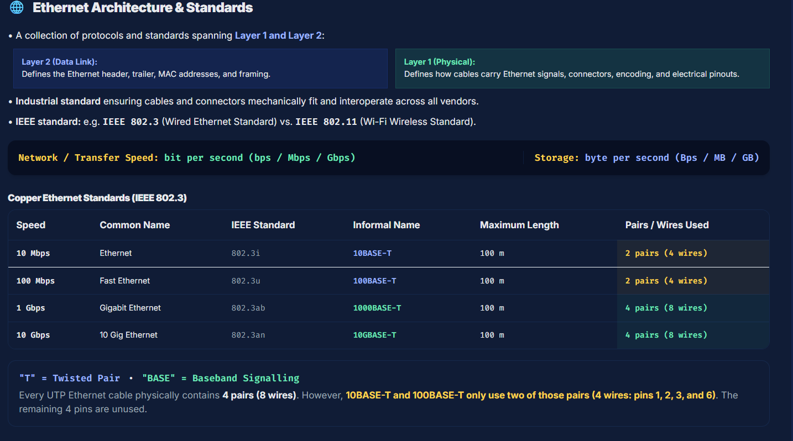
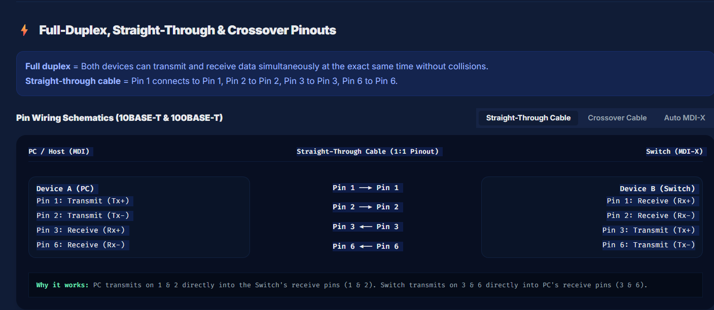
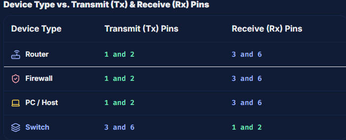
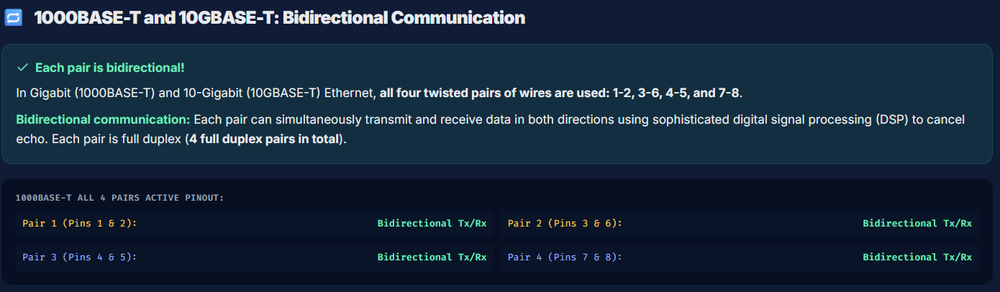
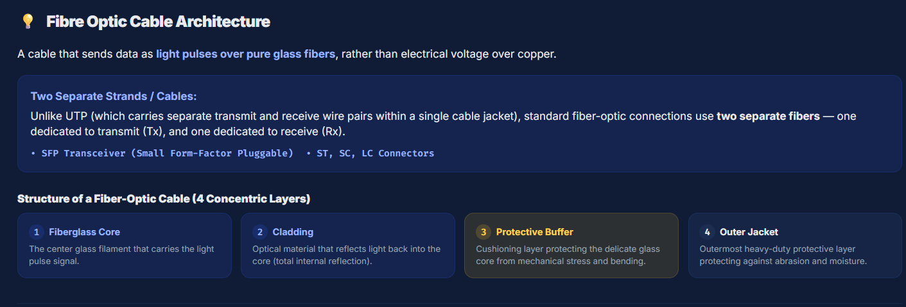
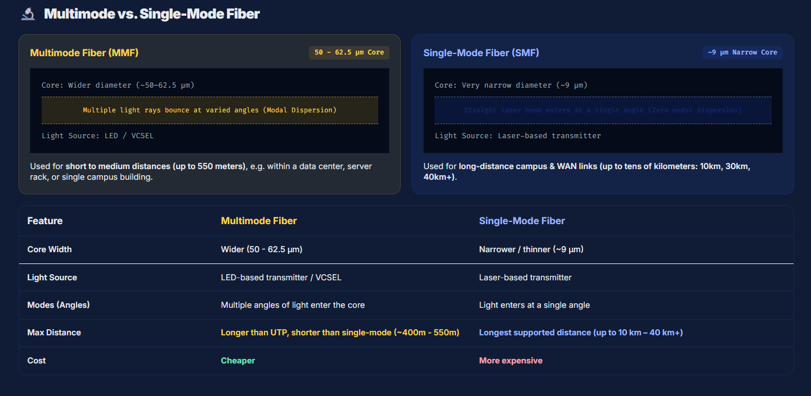
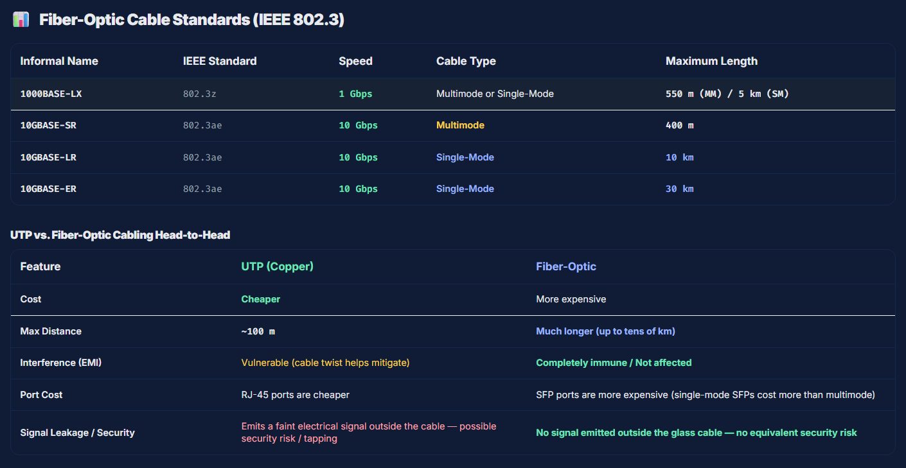

# 🔁 1000BASE-T and 10GBASE-T: Bidirectional Communication
Each pair is bidirectional!
In Gigabit (1000BASE-T) and 10-Gigabit (10GBASE-T) Ethernet, all four twisted pairs of wires are used: 1-2, 3-6, 4-5, and 7-8.

Bidirectional communication: Each pair can simultaneously transmit and receive data in both directions using sophisticated digital signal processing (DSP) to cancel echo. Each pair is full duplex (4 full duplex pairs in total).

